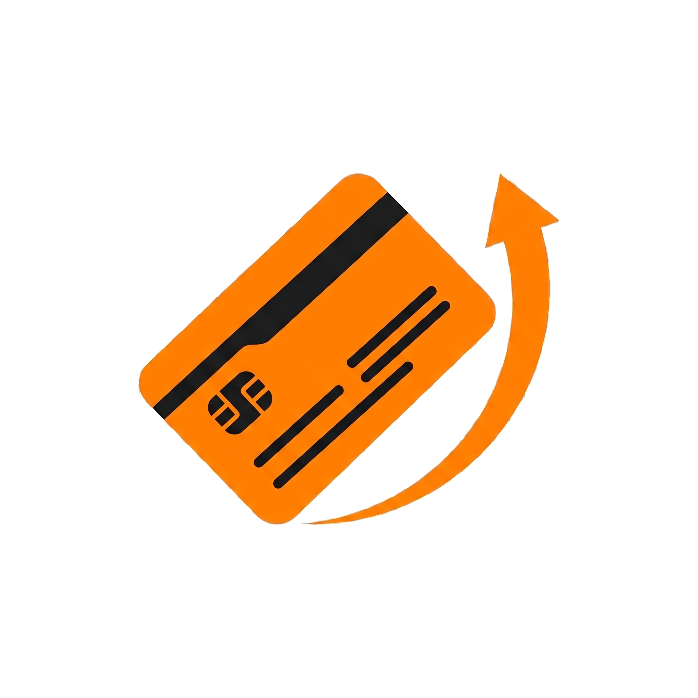
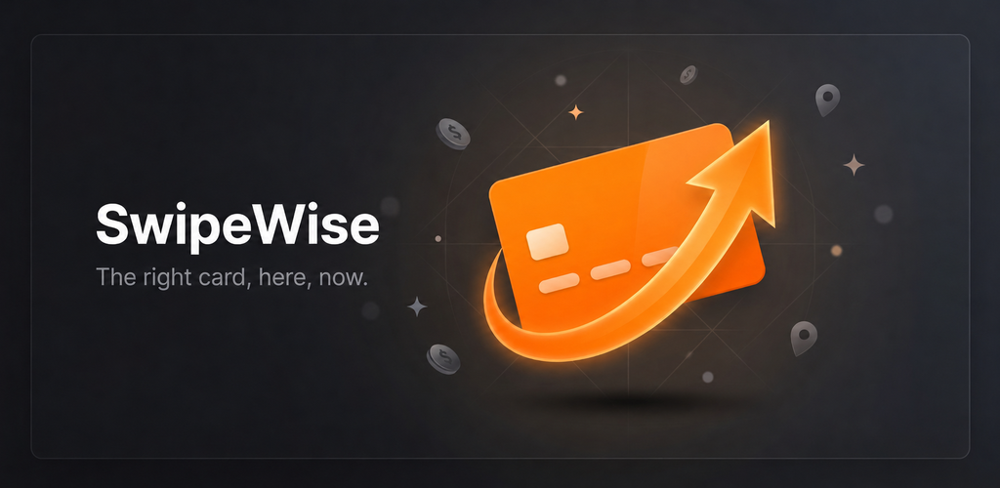
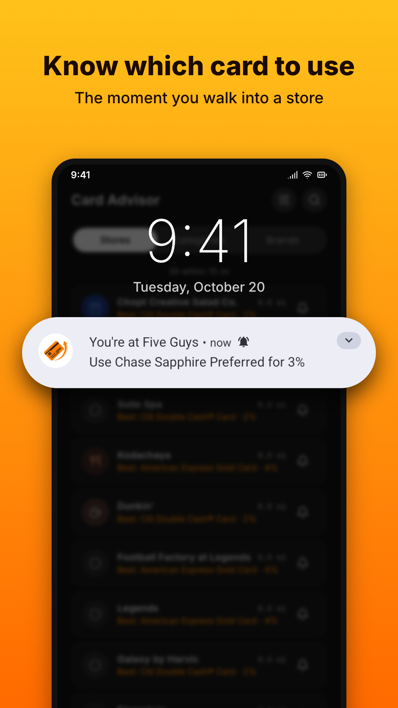
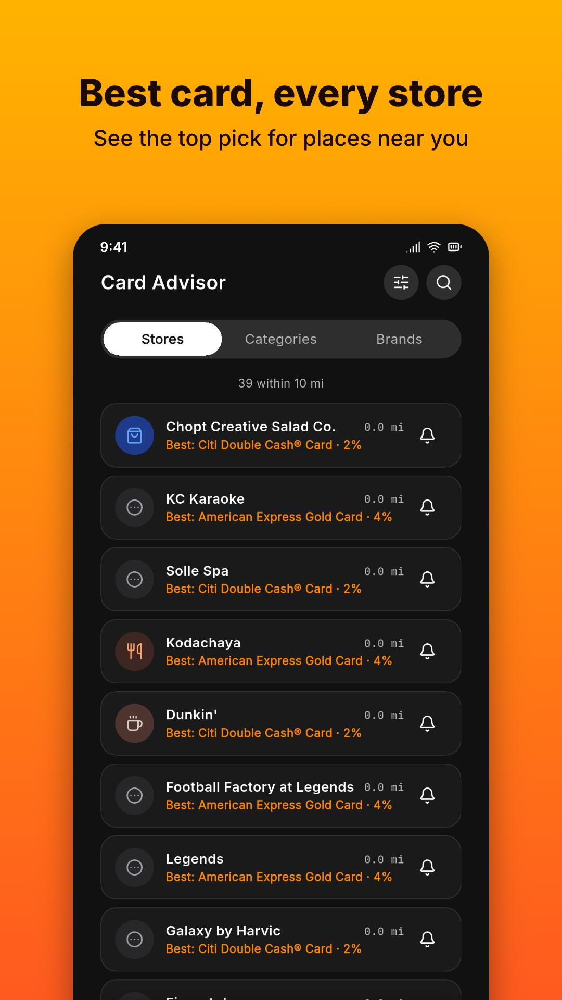
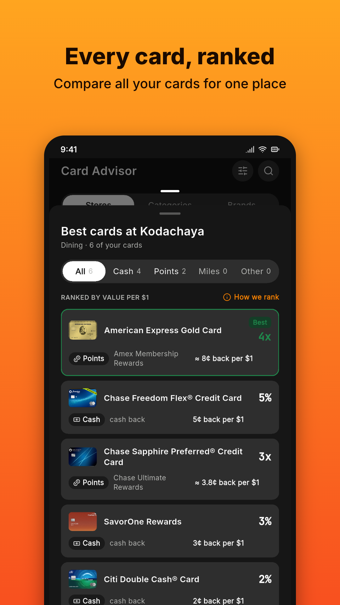
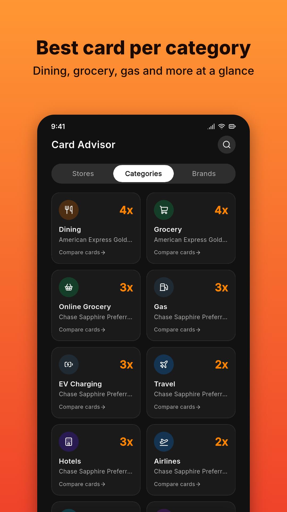
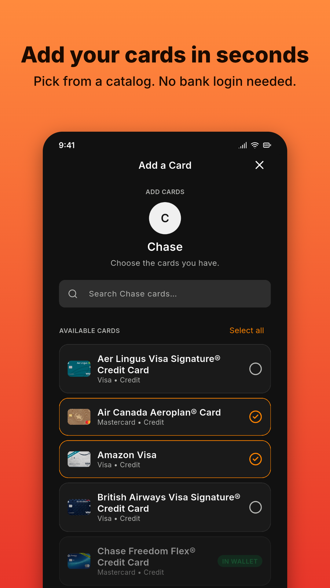
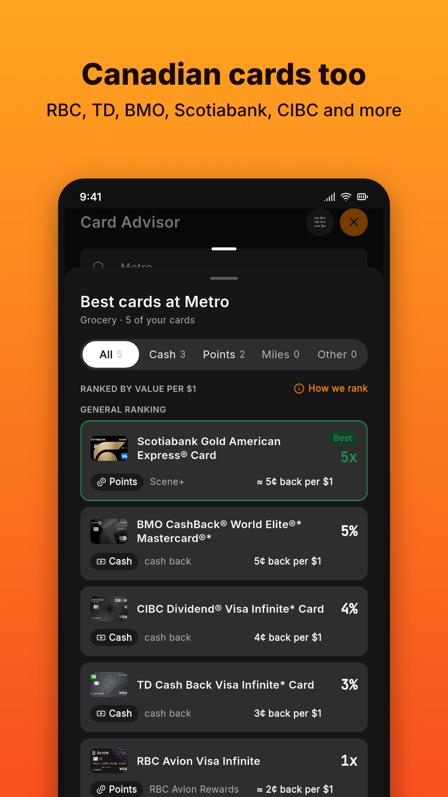

<div align="center">



# SwipeWise

### The right card, here, now.

**SwipeWise tells you which of your credit cards to use at the store you're in, so you earn the most cashback and points.** Your wallet stays on your phone. No account needed.

<br>



</div>

---

Most rewards apps stop at the category: *"use this card for groceries."* SwipeWise goes one
level deeper, to the **store and the brand**. Walk into Whole Foods and it tells you to tap
your Prime Visa for **5%**, not just "a grocery card."

## Try it

SwipeWise is free on Google Play:

**[Get it on Google Play](https://play.google.com/store/apps/details?id=com.appsoflife.swipewise)**

No account needed, and your wallet lives on your phone. Prefer to build it yourself?
See [Get started](#get-started).

## What you get

- **Best card at every store.** Store and brand level, not just categories. Whole Foods:
  Prime Visa (5%). Costco: a card Costco actually takes.
- **A nudge when you arrive.** An optional notification shows your best card as you walk into
  a store, without opening the app.
- **Your wallet in seconds.** Pick your cards from 400+ US and Canadian credit cards across
  23 issuers. No forms, no card numbers, no account.
- **Every card ranked.** The Advisor ranks every card you own by nearby store, spend category
  or merchant brand, with one search across all three.
- **Private.** Your wallet lives on your phone, and backup is opt-in. More below.

## Screens

<div align="center">
<table>
  <tr>
    <td align="center"><br><sub><b>Know which card to use</b></sub></td>
    <td align="center"><br><sub><b>Best card, every store</b></sub></td>
    <td align="center"><br><sub><b>Every card, ranked</b></sub></td>
    <td align="center"><br><sub><b>Best card per category</b></sub></td>
    <td align="center"><br><sub><b>Add your cards in seconds</b></sub></td>
    <td align="center"><br><sub><b>Canadian cards too</b></sub></td>
  </tr>
</table>
</div>

## Privacy

What leaves your phone, and what doesn't:

- **Signing in is optional.** Skip it and the app works the same, keyed to an id made on your
  phone that is never sent anywhere. Sign in only if you want a backup.
- **Backup is opt-in and off by default.** Nothing is uploaded unless you turn it on. When
  you do, it carries your cards, your edits to them and your preferences,
  [documented field by field](docs/BACKUP_SCHEMA.md).
- **No tracking, no ads.** Nothing records which cards you're shown, which notifications
  fire, or what you tap. Crash reports are the one exception, and they carry no wallet, no
  location and no account.
- **Location stays yours.** Your precise GPS fix never leaves the phone. Only a location
  rounded to about 110 m is sent to Google Places to find nearby stores.

Full details: [Privacy Policy](https://jacobcelestine.com/swipewise/privacy_policy.html).

## Built with

Flutter (Material 3), Riverpod, sqflite, Google Places API, native Android geofencing, and a
Cloudflare Worker serving the rewards catalog. Android today; iOS maybe later.

## Open source and contributing

The **app is open source**: fork it, check the privacy claims, build it yourself. The *data*
behind the recommendations is where contributions help most:

- [`assets/vocab/brands.json`](assets/vocab/brands.json) is the store and brand registry the
  app matches against, and **the file to contribute to**. Adding a store is a one-line JSON
  edit (see [docs/classifier-and-brands.md](docs/classifier-and-brands.md)).
- [`assets/catalog/free.json`](assets/catalog/free.json) is the rewards **catalog**: card
  products, earn rules, point values and perks. It is generated by a separate data pipeline,
  so a direct edit gets overwritten on the next publish. Card-data fixes go through the
  pipeline rather than a PR here. The app fetches it from the catalog API, so fixes ship
  without an app release (see [docs/reward-catalog.md](docs/reward-catalog.md)).

Good first contributions: add the stores you shop at. Start with the
[architecture overview](docs/architecture.md) to see how the pieces fit.

## Get started

Requires the Dart SDK 3.12 or later (built with Flutter 3.47, stable channel).

```bash
flutter run --dart-define-from-file=keys.free.json
```

`keys.free.json` is committed: it holds three public URLs and no credential. The Places key
lives in a Cloudflare Worker, and the app talks to that rather than to Google directly.
`tool/verify_release_apk.py` fails the build if a credential ever reaches the APK, and runs on
every pull request.

Full build, release and keys details: [docs/setup.md](docs/setup.md).

## Documentation

| Doc | Covers |
|---|---|
| [Architecture](docs/architecture.md) | How the app, classifier and catalog fit together |
| [Classifier & brands](docs/classifier-and-brands.md) | How a merchant becomes a recommendation |
| [Reward catalog & engine](docs/reward-catalog.md) | Catalog data and the reward engine and ranker |
| Catalog API *(separate private repo)* | The Cloudflare Worker that serves the catalog. Server code lives outside this repo so user-data infrastructure never shares a deploy with the public catalog API; see [what a wallet backup stores](docs/BACKUP_SCHEMA.md) |
| [Nearby & geofences](docs/nearby.md) | Google Places search, tile cache, geofences, notifications |
| [Database](docs/database.md) | Full SQLite schema |
| [Setup](docs/setup.md) | Keys, build flags, git hooks, troubleshooting |
| [Privacy](https://jacobcelestine.com/swipewise/privacy_policy.html) | What's collected, where it goes, what's never stored |

## License

[MIT](LICENSE). Use it, fork it, ship it. Attribution and the licence text are the only
conditions.

One thing worth knowing: the recommendations are only as good as the data behind them, the
brand registry and the rewards catalog. Keeping 400+ cards accurate as issuers reword their
terms is the ongoing work. `assets/vocab/brands.json` is the file to send a PR against; card
data goes through the pipeline rather than a direct edit
(see [docs/reward-catalog.md](docs/reward-catalog.md)).
