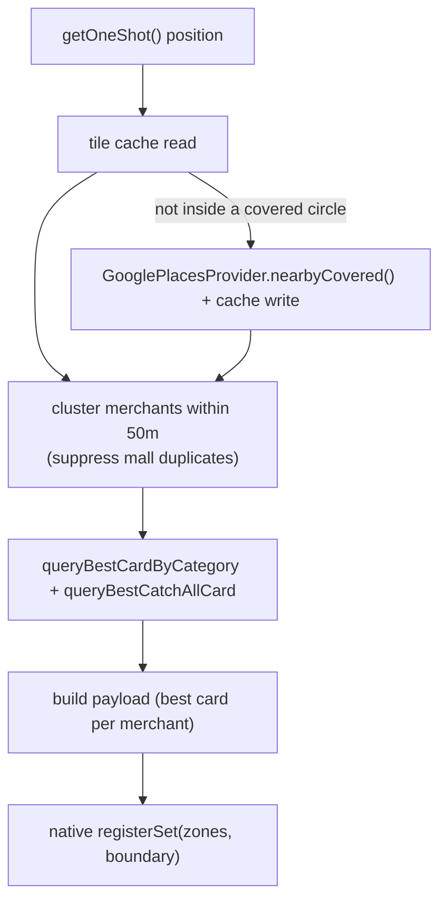

# Nearby stores

How "you're near a store, here's your best card" works — Google Places for place discovery, a
native `GeofencingClient` for dwell detection, and the same classifier/ranker as everywhere else.

## Fetch + tile cache

[`google_places_provider.dart`](../lib/nearby/google_places_provider.dart) — `nearby()` posts
to the Google Places API (New) `places:searchNearby` endpoint with a field mask covering only
Basic-tier fields (`places.id`, `places.displayName`, `places.location`, `places.primaryType`,
`places.businessStatus`). A `NearbyMerchant` keeps only `id`, `name`, `placeType`, `lat/lng`,
`distanceMi` — everything else is dropped. Results are sorted nearest-first (Haversine
client-side; the API doesn't return distance).

Privacy coarsening: lat/lng is rounded to 3 decimal places (~110 m) before sending.

[`tile_cache.dart`](../lib/nearby/tile_cache.dart) caches results per **~1km grid cell**
(`cell_id = "{round(lat*100)}:{round(lng*100)}"`) in `merchant_tile_cache`:
- **7-day TTL**, **200-cell LRU** (evicted on write by `last_accessed_at`).
- **A search is complete only near its centre.** Each request returns at most 20 places,
  nearest first, with no next page (`maxResultCount` is capped at 20 by the API). In a
  dense town that's ~300 m, far short of the search radius. So each search records its
  covered circle (`NearbySearchResult`): the search radius when every request came back
  short of 20, else the smallest of the full requests' farthest-result distances (0 if a
  request failed). Cached rows carry it (`center_lat`, `center_lng`, `covered_m`, DB v18).
- **A read is a hit only inside a covered circle**, with at least `TileCache.edgeM`
  (150 m) to spare; otherwise the caller searches afresh from where the user is. Before
  this, any fresh row in the 3×3 neighbourhood counted, so an arrival 500 m from an old
  search got that search's ring and the store being walked into was never fenced
  (Flemington, 2026-10-16). On a hit, rows from the whole **3×3 neighbourhood** are
  merged, deduped by `merchant_id`, and sorted by distance. Rows from before v18 have no
  coverage and never count as a hit.
- Cost: about one search (2–3 requests) per stop outside every cached circle.
- A cross-isolate circuit breaker (3 failures → 5-min cooldown) in `api_circuit_breakers`
  protects the API.

## Place roots

[`place_roots.dart`](../lib/nearby/place_roots.dart) defines 10 `PlaceRoot` groups (dining,
retail, travel, arts, sports, business, event, health, outdoors, community). Each group carries
a list of Google `includedTypes`; all enabled groups' types are merged into one API call. The
user toggles groups on/off in the nearby-categories screen; preference is stored under
`nearby_place_type_ids` in the `settings` table.

## Category labels

[`google_place_type_map.dart`](../lib/nearby/google_place_type_map.dart) maps Google
`primaryType` strings → display labels (`'restaurant'` → `'Dining'`, `'gas_station'` →
`'Gas'`, etc.). [`category_label_resolver.dart`](../lib/nearby/category_label_resolver.dart)
tries this map first, then falls back to name-substring heuristics.

EV charging stations (`electric_vehicle_charging_station`) now map to their own
`'EV Charging'` label — split out of `'Gas'` (a gas subcategory, mirroring transit under
travel). Five newer reward categories (apparel, electronics, sportingGoods, pets, medical)
are **reward-only for now**: their Google place types aren't yet wired into this map or the
place-roots search, so nearby detection doesn't route to them (a known follow-up).

## Location & permissions

[`location_service.dart`](../lib/nearby/location_service.dart) `getOneShot()` returns
`(lat, lng)` via Geolocator (medium accuracy, 10s timeout).

[`nearby_permission_gate.dart`](../lib/nearby/nearby_permission_gate.dart) runs an up-front
gate once per install, in a deliberate order (avoids a dialog race): notifications →
activity recognition → foreground location → explainer → background location (deep-links to
Settings on Android 11+). The OS won't grant background without foreground first.
`permissionGateCompleteProvider` blocks the Stores tab until the gate finishes.

Two background-reliability grants — **exact alarms** (SCHEDULE_EXACT_ALARM, denied by
default on Android 14+; powers the app-side dwell timers) and **ignore battery
optimizations** (OEM battery managers killing receivers is the top real-world cause of
silently missed alerts) — are detect-and-nudged, not one-shot asked: the Stores view
(also embedded in the Advisor tab) watches `reliabilityGrantsProvider` and shows a
banner while either grant is missing, exactly like the background-location banner.
Both degrade gracefully when declined; each `registerSet` logs their status to the
debug trail.

## Geofence registration

[`geofence_manager.dart`](../lib/nearby/geofence_manager.dart) `ensureRegistered()` is
idempotent (runs on app open):



Merchants within 50 m share one fence (a "cluster"). **Fence ids are anchored on place id**
(`m_<lowest place id in the cluster>`), not on the store nearest the user at registration —
that used to rename the same strip mall on every re-register and orphan any dwell timer
already running for it (`no_meta`). Each option carries its store's own lat/lng so the dwell
check can tell the stores in a cluster apart.

Each merchant gets a **100m ENTER/EXIT geofence**. A big-box store's (department,
warehouse, supermarket, hypermarket, home improvement, mall) is 80 m larger, and its
options carry `footprint_m` = 80. Its Google pin can sit 150 m from where the user stands
inside, so the native dwell check measures to the store's edge (distance − footprint).
A cluster's dwell is the **shortest** wait among its stores. "Department Stores" and
"Wholesale" use the **Big-box** wait setting, which before this mapping changed nothing.

A single **boundary geofence** acts as a re-registration tripwire. Its radius is the
search's **real coverage around the user** (what's left of the covered circle; capped at
the farthest kept fence when the 50-fence cap dropped some), clamped 300 m–10 km. Both
earlier formulas overshot coverage: "furthest merchant + 500 m", then the median fence
distance clamped to ≥1 km. Either way you could park beyond the fenced stores yet inside
the boundary: no EXIT, no re-registration, no notification. The native side
([`GeofencePlugin.kt`](../android/app/src/main/kotlin), channel `com.appsoflife/geofence`)
uses Google Play Services `GeofencingClient` with `INITIAL_TRIGGER_ENTER` (so a fence
registered around a store the user is already standing in still fires) — the OS monitors
geofences even when the app isn't running.

**Re-registration triggers** (how fences follow the user):

- App open / settings change / sync completion (Dart side, debounced).
- Boundary EXIT while **not** driving → expedited `ReregisterWorker` immediately.
- Boundary EXIT while **driving** → `PendingReregister` flag + a 5-min fallback alarm;
  the flag is consumed (worker runs) on the next activity-recognition STILL/WALKING
  transition, or by the fallback alarm if AR never delivers one (it re-arms itself while
  still driving). No churn mid-drive; fences land at the destination on arrival.
- Boot (Android wipes geofences on reboot). Boot also **restarts activity recognition** —
  only `MainActivity` used to start it, so after any reboot "driving" was never detected
  until the app was opened, and the boundary re-registered mid-drive with fences centred
  on the road (diagnosed 2026-10-16). `ReregisterWorker` re-asserts it too.

The worker is **expedited** (`RUN_AS_NON_EXPEDITED_WORK_REQUEST` fallback) — a plain
request can be deferred minutes under Doze, which defeats fencing the destination before
the user walks into a store.

**Searches stay where you stop.** On foot, a boundary EXIT re-searches at most once per
5 min (`FootReregister`); a later crossing leaves it owed to the fallback alarm. The worker
itself defers while AR says driving, so neither the 12-hour validation run nor a boot fences
a highway.

**Registrations never overlap.** Two interleaved `registerSet` calls can leave fences from
one run and metadata from the other (`no_meta`). In-isolate calls to `ensureRegistered`
queue behind each other. The worker is enqueued with `APPEND_OR_REPLACE`: `REPLACE` only
interrupted the running worker's latch while its Flutter engine kept going.

**`registerSet` reports what the OS did, not what it was asked.** `addGeofences()` is
asynchronous, so returning normally only means the request was accepted for delivery —
Play services can still reject it (`GEOFENCE_NOT_AVAILABLE` when location is off,
`GEOFENCE_TOO_MANY_GEOFENCES` at the per-app cap). The plugin therefore awaits both add
tasks before answering. A rejection surfaces as `ADD_FAILED`, which `ensureRegistered`
turns into `Result.retry` for the worker. Note the trade this makes explicit: the
`removeGeofences` calls have already run by then, so a failed re-register leaves the
device with **no** fences rather than the last-good set — the retry is what recovers it.

## Dwell detection

Dwell is decided **app-side**, not by the OS: `GEOFENCE_TRANSITION_DWELL` evaluates
loitering lazily on the OS's own location cadence and can fire minutes late. Instead:

1. Fence **ENTER** → `MerchantGeofenceReceiver` arms a one-shot [`DwellAlarms`] timer for
   that fence's per-category dwell seconds (exact alarm when granted, inexact otherwise).
   A timer already counting down is left alone. Indoor fixes drift across the fence edge,
   and re-arming on each repeat ENTER restarted the countdown.
2. Fence **EXIT** before it fires → timer cancelled (drove past / red light).
3. Timer fires → a **resident fence** is skipped before any fix (`ResidentGuard`,
   outcome `resident`). Three checks on one fence within an hour means the user lives or
   works beside it (a home business pinned next door), so the fence stays silent for
   7 days. A real visit is one check, two with a moving recheck.
4. Otherwise `DwellCheckReceiver` takes **one fresh balanced-power fix** (8s budget)
   and verifies: fix inside the fence (+accuracy +50m slack) → post; fix outside →
   rejected; no fix obtainable → post unless activity recognition says IN_VEHICLE
   (fail-open — a missed verification must not eat a legit notification).
   **Inside but still moving** (AR says IN_VEHICLE or WALKING, or the fix's speed is over
   2 m/s) is a red light beside the store or someone walking past: a 1-min wait is shorter
   than walking through a 100 m fence, and AR reports stop-and-go city traffic as walking.
   The timer re-arms once (`moving_recheck`), the second look trusts the fix alone, and an
   EXIT in between cancels it. A fix coarser than 50 m gets the same second look
   (`coarse_recheck`); indoors the next one is usually far sharper. The second look asks
   for `PRIORITY_HIGH_ACCURACY` (GPS blended with wifi): a few seconds of GPS, only on a
   recheck, to tell stores ~25 m apart. The first look stays balanced-power.
5. With a fix, **which store to name is decided across every registered fence**
   (`StoreResolver` in `Walkin.kt`), not just the one that fired — fences overlap, so the
   firing one is often a neighbour's. Stores count when within the same reach that
   verified the visit, measured to their edge; muted stores are dropped first. If the
   closest is more than 60 m + the fix's accuracy away, the user isn't in a store
   (`not_at_store`; on 2026-10-17 a red light 93 m from a nail salon posted it). The
   closest store is named alone (after **folding** any store whose card advice equals a
   nearer one's: Costco's bakery, food court and kiosk fold into Costco Wholesale, while a
   Starbucks inside a Target stays because coffee earns differently); only stores within 35 m of the closest become a "you may
   be at one of these" list (max 4). Fix accuracy worse than 50 m, no fix, or no store
   within reach → the firing fence's own options, closest four.

Activity state: an IN_VEHICLE **EXIT** is stored as "not driving". IN_VEHICLE then counts
for 2 h. Transitions arrive only on a change, so the old 30-min cutoff read every longer
drive as parked.

**Remembered picks.** Two pins at one address (a supermarket and the pharmacy in the same
building) can't be separated by any fix. Tapping a store in the "one of these" sheet records
it in `store_picks` (DB v19, newest 500 kept, device-level). Next time that store is in a
list it goes first and the alert reads "You're probably at X · or Y — tap to switch".
Nothing is dropped, and the most recent pick wins, so visiting the other store is one tap.

**One walk-in, one notification.** After a store alert posts, any other alert within 250 m
in the next 20 minutes is the same visit (`VisitLock`, outcome `same_visit`). The window
slides: each held-back alert restarts it, so it lasts as long as the stay (a fixed window
let a 36-minute Costco trip post twice). Overlapping
fences entered seconds apart used to each post, since neighbouring stores have different
categories and the per-category cooldown never caught them. The 20 minutes must exceed
the longest wait setting (15 min), since overlapping fences can have different waits.
**Known limit:** walking to the shop next door within the window stays silent.

**Logs (release builds too):** every receiver writes one line under tag `SW.walkin` — fence
ENTER/EXIT (with `no_meta` marks and fix accuracy), boundary EXIT and whether it deferred,
activity transitions, boot, `registerSet`, and each dwell decision (candidates with
distances → the store named → outcome). Dart writes one `geofence:` line per registration
into the same log (trigger, cache vs search, merchant/cluster counts, covered radius,
overlapping fence pairs, boundary), including failures and "found nothing". Before this,
"fences were never set up here" left no trace after a day out.
In **debug builds only**, the same lines are appended to **`files/walkin.log`** in the app's storage
(capped at 512 KB, trimmed to the newest half), because the phone is rarely plugged in when a walk-in
happens. After a day out: `adb exec-out run-as com.appsoflife.swipewise.dev cat files/walkin.log`. Store
builds never write it — it is a list of stores visited, with times, and the background-location
disclosure promises no history of where you've been — and delete any copy 1.0.4 left behind. Logcat's default buffer holds minutes on a busy
phone; when you do stay plugged in, first run
`adb logcat -G 16M`, then `adb logcat -d -s SW.walkin flutter` (Dart lines arrive under the `flutter` tag, prefixed `[SW.geofence]`).

Fence geometry + dwell seconds ride along in `GeofenceMetadataStore` so the receivers
need no Dart round-trip.

### Outcome trail (temporary)

`DwellCheckReceiver` has seven exits and six of them are a bare `return`, so a
correctly-suppressed drive-by and an eaten real visit look identical from outside —
both are just silence. A device pulled on 2026-08-16 had **12 dwell timers fire over
two days and only 5 post**, with nothing on the device able to say which path ate the
other 7.

`DwellOutcomeStore` writes one `dwell_outcomes` row per fired timer (DB v15,
**debug builds only**, capped at 500, best-effort):

| outcome | meaning |
| --- | --- |
| `posted` | notification shown |
| `no_meta` | fence set replaced mid-flight — frequent means re-registration is racing arrivals |
| `outside_fence` | verification fix put the user outside; `distance_m` vs `allowed_m` says by how much |
| `no_fix_driving` | no fix in time and AR still says driving |
| `moving_recheck` / `coarse_recheck` | inside but moving, or fix too coarse; re-armed once |
| `not_at_store` | inside the fence, but no store close enough to be the one you're in |
| `resident` | fence keeps firing (home/work); skipped without a fix |
| `notifications_off` | post attempted, but notifications are off; no cooldown or visit lock set |
| `muted` / `same_visit` / `merchant_cooldown` | suppressed on purpose |
| `category_cooldown` | older builds only; that cooldown is gone |

`distance_m`/`accuracy_m`/`allowed_m` are set whenever a fix was obtained, so a `posted`
row with no distance is itself the marker that verification failed open. Read it with:

```
adb exec-out run-as com.appsoflife.swipewise.dev cat databases/swipewise.db > /tmp/sw.db
sqlite3 /tmp/sw.db "SELECT datetime(at/1000,'unixepoch','localtime'), merchant_name,
  outcome, round(distance_m), round(allowed_m) FROM dwell_outcomes ORDER BY id DESC;"
```

**This is a rig, not a feature.** Its ancestor `debug_trail` went in at DB v6 and was
dropped at v8 once it had proven the pipeline. Delete the table, `DwellOutcomeStore.kt`
and its call sites the same way once the silent drops are attributed.

## Recommendation

For each nearby merchant the payload is built with the **same** classifier + ranker as the
sync path, just with two inputs instead of one ([architecture.md](architecture.md)):

- **category** ← `classifyLooseLabel(CategoryLabelResolver.labelFor(placeType, name))`
- **brand_id** ← `BrandResolver.resolve(merchant.name)` (built from `brands.json`)
- **best card** ← `byBrand[brand_id]` if matched, else `byCategory[category]`, else catch-all

## Notifications

Before posting, `DwellCheckReceiver` checks the visit lock (above) and one cooldown,
backed by a SQLite table shared with the app:

- **per-merchant** — 6h (don't re-nudge the same store), with a smart re-arm: a
  **boundary EXIT clears all merchant cooldowns** — leaving the mapped area makes the
  next visit a new trip, so returning re-notifies. Walking to the car and back never
  crosses the boundary, so same-visit repeats stay suppressed by the 6h window.

The old 30-min **per-category** cooldown is gone. The visit lock does its burst-guard job,
and it silenced real second visits, like dinner and then dessert across the road.
(`category_notification_cooldown` stays in the schema, unwritten.)

`postDwell` reports whether the notification could show. With notifications or the
channel off, nothing counts as posted (`notifications_off`).

The notification names the brand-specific card when matched ("Use Prime Visa at Whole Foods
· 5%"), else the category's best card. Tapping carries the options JSON into the app, which
the Dart side consumes via `consumePendingMerchant()`.

## Muted stores

Any store in the Nearby list can be muted from its row (the bell toggle), which stops its
dwell notifications without hiding it from the list. Muted place ids live in the
device-level `muted_merchants` table (DB v7, `merchant_id` = Google place id) — not
user-scoped, matching the cooldown tables, since the native receivers read it without a user
context. Mute/unmute writes happen only in Dart (`DataRepository.muteMerchant` /
`unmuteMerchant`); native only reads. Manage the full list under **Profile → Alert timing & muted stores**. Search distance and kinds of places
live only in Advisor's filter sheet (the tune button in Stores view), since they set what the list shows;
the alerts page points there because the kinds also decide which stores get a fence.

Suppression happens at two layers:

- **Registration (Dart).** `GeofenceManager.ensureRegistered` drops muted merchants before
  building the fence set, so no fence is registered for them at all (this also frees a slot
  under the 50-fence cap). A mute/unmute triggers an immediate re-register (`trigger:
  'mute'`) so the change lands without waiting for the next boundary EXIT.
- **Post (native, belt-and-braces).** A fence registered *before* the mute is still in
  flight, so `DwellCheckReceiver.maybePost` re-checks `muted_merchants` (via the read-only
  `MutedStore`) *before* the cooldown checks. A single-merchant fence is suppressed when its
  merchant is muted; a **cluster** ("you may be at one of these") is suppressed only when
  *every* option is muted — one live option still earns a post. Fail-safe: any DB open/read
  failure reads as "not muted", so a transient miss never eats a legit notification.

This exists because a store whose 100m fence overlaps home re-notified on every return trip
(the boundary-EXIT cooldown re-arm defeats the 6h per-merchant window for an at-home fence).

## Notes

- `ACTIVITY_RECOGNITION` lets the OS distinguish a real dwell from a traffic stop.
- ⚠️ **Google's place types are hierarchical, and `includedTypes` matches the whole `types[]`
  array — not just `primaryType`.** Searching `restaurant` already returns pizzerias, delis and
  coffee shops; `lodging` already returns hotels, motels and hostels; `transit_station` already
  returns train, subway and bus stations; `food_store` already returns supermarkets, groceries and
  convenience stores. Listing the children buys nothing.
  That matters because the bill is a **step function**: `includedTypes` is capped at 50, so each
  tile costs `ceil(types / 50)` billed Nearby requests. Trimming the default set from 146 to 75
  (measured 2026-08-15 — see the note atop `place_roots.dart`) took it from 3 requests to 2, a
  third off Places spend with no measured loss of merchants. A trim that does not cross a multiple
  of 50 saves **nothing**, so measure before trimming.
  The dropped types are still live downstream: a pizzeria arrives as `primaryType:
  pizza_restaurant`, so `categories.json` and `kGooglePlaceTypeToLabel` must keep entries for them.
  `kTypesReachedViaParentType` records the set, and the vocab test asserts reachability against it.
- **No Places key is baked into the app.** Nearby search posts to `PLACES_PROXY_URL` — the
  Worker's `/places/nearby` — which holds the Google Places key as a server-side secret and
  forwards the request. The app attaches a Firebase App Check token (`X-Firebase-AppCheck`);
  the Worker verifies it against Google's JWKS with the audience pinned to the project, and
  **rejects unattested callers with 401**.
- App Check is activated in *both* isolates. Geofence re-registration runs headless and calls
  Places itself, and App Check state is per-isolate — activating only in `main()` leaves that
  path tokenless, so geofences silently stop re-registering.
- The **catalog** fetch (`remote_asset_service.dart`) sends the token too. Client-side rollout
  must lead server-side enforcement, and that order must never be inverted: `catalog_loader.dart`
  falls back to the bundled offline copy, so a rejected catalog fetch is invisible to the user and
  would strand un-updated installs on a stale catalog with nothing to show for it. The backend
  repo owns the sequencing.
- ⚠️ **Attestation is not free — but do NOT add a token cache.** A Play Integrity round trip
  measured **~2.2 s**. `getToken()` already "will use a cached token if found in storage" and
  "attaches to the most recent in-flight request if one is present" — *storage*, so the cache
  outlives an isolate. A second cache in app code would only fight the SDK's own refresh. The
  in-flight attaching did **not** hold at launch (see below), so `AppCheckService.token()` shares
  the one in-flight request itself — cleared on completion, so it is not a cache. What matters is *when* the cold
  round trip happens: the token fetch sits **before** the HTTP timeout, so paying it inside the
  first nearby search reads as a hung Stores tab. `AppCheckService.warm()` starts it at activation
  in both isolates instead, and a search that fires meanwhile attaches to it. Every build logs
  `SW.appcheck` at WARN when a call exceeds 250 ms — measured **~1.9 s** on a Pixel 10 Pro
  (2026-08-13), which corroborates the original hand-timed figure.
- ✅ **Measured end to end on a Pixel 10 Pro, 2026-08-13 — 13 calls, 0 failures:**

  | | |
  |---|---|
  | cold round trips | **2** (1,634 ms and 2,562 ms), both during startup |
  | served from cache | **11** — 3 ms to 224 ms, median well under 70 ms |

  So **successful tokens are cached and an app-level cache would be redundant**, and `warm()` does
  what it was added for: both cold trips land at launch, and the burst of eight real API calls
  eight seconds later is entirely warm. One call also demonstrably *attached to an in-flight
  request* — it returned 224 ms after starting, 10 ms behind the cold trip it joined.

- ⚠️ **A FAILED attestation is not cached, so it repeats on every call**, and once the SDK enters
  backoff it rejects locally in single-digit ms — which looks exactly like a cache hit unless the
  log line also states the outcome. That is why `SW.appcheck` always prints `ok`/`FAILED`.
- **Concurrent callers miss the SDK's attach.** 2026-08-13: two cold trips, the second starting
  ~26 ms before the first completed (~2.5 s of startup work). A 2026-10-15 launch logged ~15 slow
  (300–480 ms) calls inside one second. Since 2026-10-16 `token()` shares one in-flight request
  across concurrent callers (`test/api/app_check_service_test.dart`); not yet re-measured on a
  device — expect ONE `SW.appcheck` WARN line per isolate at launch.
- ⚠️ Open thread, not user-blocking: the **geofence isolate** was never exercised. Absolute timings are the *debug*
  provider's; Play Integrity measured ~1.9 s, so the same shape at a higher constant.
- Why the proxy exists: the app used to call Google directly with an Android-restricted key.
  That restriction is matched from `X-Android-Package` / `X-Android-Cert`, which for raw HTTP
  calls are strings the client sets — and they travelled in the same binary as the key. A
  `curl` forging both returned real Places data, so the restriction protected nothing. Play
  Integrity attestation at the Worker replaces it, and unlike a header it cannot be copied out
  of the APK.
